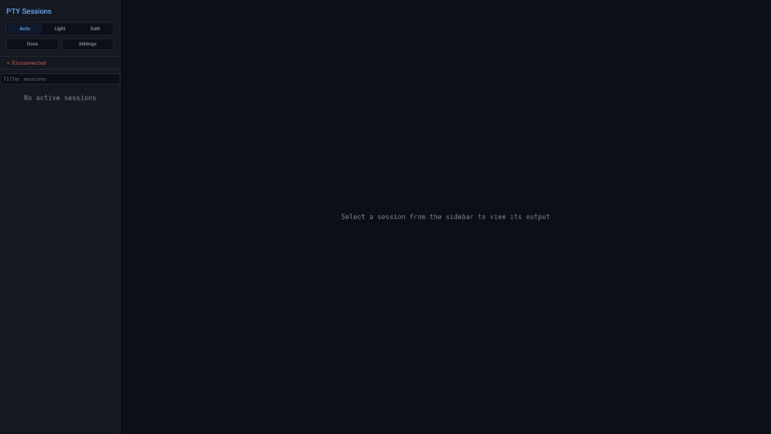
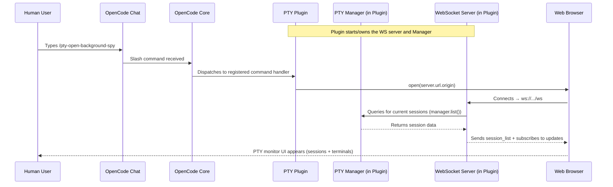
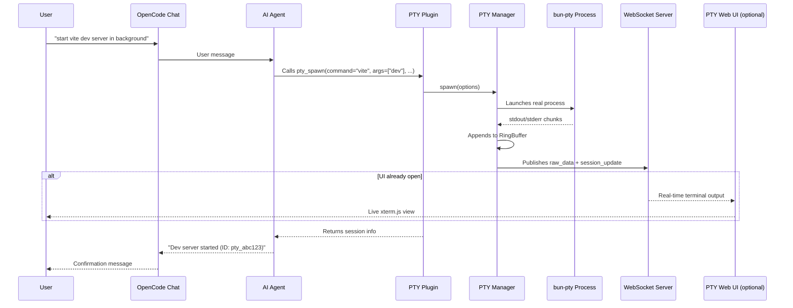
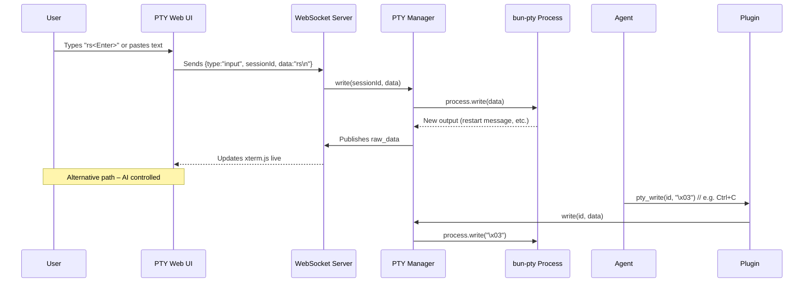
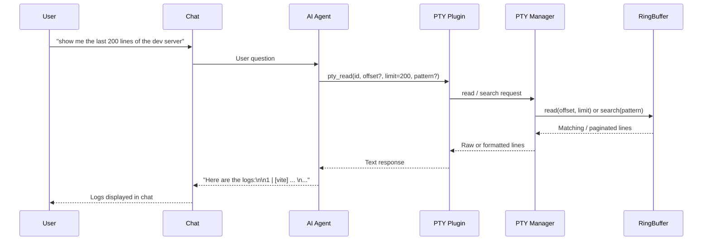
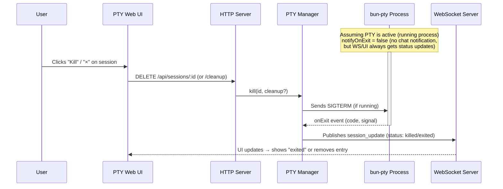
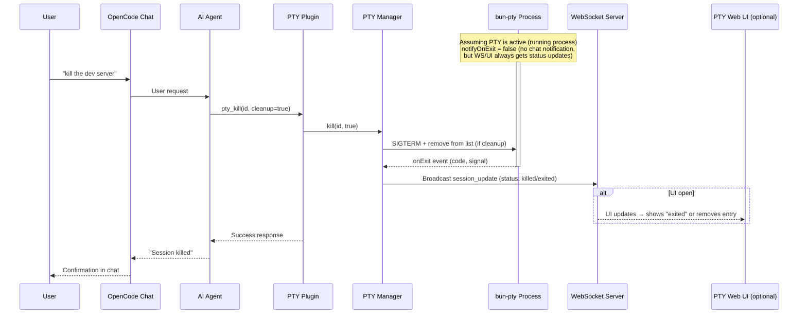
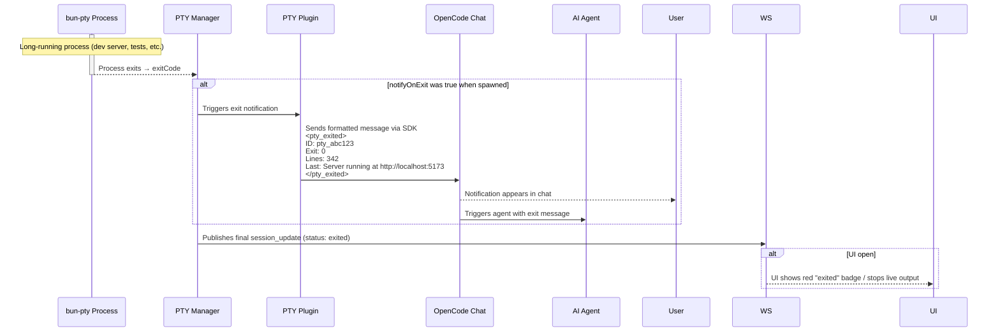

# opencode-pty

A plugin for [OpenCode](https://opencode.ai) that provides interactive PTY (pseudo-terminal) management, enabling the AI agent to run background processes, send interactive input, and read output on demand.

> **Upstream:** [shekohex/opencode-pty](https://github.com/shekohex/opencode-pty) is the upstream project. This repository is a fork. The features documented here are kept in a shape that can be contributed upstream, and the currently maintained version of this fork lives on the `local/modernized` branch.

## Why?

OpenCode's built-in `bash` tool runs commands synchronously—the agent waits for completion. This works for quick commands, but not for:

- **Dev servers** (`bun run dev`, `cargo watch`)
- **Watch modes** (`bun test --watch`)
- **Long-running processes** (database servers, tunnels)
- **Interactive programs** (REPLs, prompts)

This plugin gives the agent full control over multiple terminal sessions, like tabs in a terminal app.

## Features

- **Background Execution**: Spawn processes that run independently
- **Multiple Sessions**: Manage multiple PTYs simultaneously
- **Interactive Input**: Send keystrokes, Ctrl+C, arrow keys, etc.
- **Output Buffer**: Read output anytime with pagination (offset/limit)
- **Pattern Filtering**: Search output using regex (like `grep`)
- **Exit Notifications**: Get notified when processes finish (eliminates polling)
- **Wait for Completion**: Block on a session until it exits, with an optional timeout
- **Permission Support**: Respects OpenCode's bash permission settings
- **Session Lifecycle**: Sessions persist until explicitly killed
- **Auto-cleanup**: PTYs are cleaned up when OpenCode sessions end
- **Web UI**: Modern React-based interface for session management
- **Session Groups**: The Web UI groups sessions by their parent OpenCode session
- **Accurate Terminal Emulation**: Mouse reporting, selection and true-color queries
- **Real-time Streaming**: WebSocket-based live output updates

## Setup

### OpenCode V1

Add the plugin to your [OpenCode config](https://opencode.ai/docs/config/):

```json
{
  "$schema": "https://opencode.ai/config.json",
  "plugin": ["opencode-pty"]
}
```

### OpenCode V2

OpenCode V2 uses the new plugin API. You can load `opencode-pty/v2` and optionally configure options (such as a fixed web UI port):

```json
{
  "$schema": "https://opencode.ai/config.json",
  "plugin": [
    {
      "package": "opencode-pty/v2",
      "options": {
        "port": 4200,
        "hostname": "127.0.0.1",
        "autostart": false
      }
    }
  ]
}
```

| Option | Type | Default | Description |
| --- | --- | --- | --- |
| `port` | `number` | `0` (ephemeral) | Fixed port for the PTY Web UI observer server |
| `hostname` | `string` | `"::1"` | Hostname to bind the PTY Web UI server to |
| `autostart` | `boolean` | `false` | Automatically start the Web UI server on startup |
| `retention` | object | see below | How long archived sessions are kept, and how many |

### Archive retention

`retention` governs the on-disk archive that keeps a finished session's output readable.

```json
{
  "retention": { "maxSessions": 500, "maxAgeDays": 30 }
}
```

| Field | Default | What it does |
| --- | --- | --- |
| `maxSessions` | `200` | Newest sessions kept; older ones are pruned. |
| `maxAgeDays` | `14` | Sessions older than this are pruned. |
| `maxBytesPerSession` | `5242880` | Per-session log cap; beyond it the log rotates once. |

Anything omitted keeps its default. A session is pruned by whichever rule bites first, and a
session that is still running or being stopped is never pruned - the other two rules would
remove its directory while output is still being written to it.

Lowering a cap takes effect at once rather than at the next start: the archive is re-pruned
and sessions are removed immediately. They are moved to a `.trash` directory rather than
deleted, so they stay restorable until the next start, the same window a normal removal gets.

The values in force are shown in the Web UI under **Settings → Archive**. They are read from
the server that enforces them, so a configured override is visible without editing a config
file.

OpenCode will automatically install the plugin on next run.

## Updating

OpenCode automatically checks for and installs plugin updates on startup. You don't need to do anything manually!

If you ever need to force a clean reinstall, you can clear the cache:

```bash
rm -rf ~/.cache/opencode/node_modules/opencode-pty
opencode
```

## Tools Provided

| Tool        | Description                                                                 |
| ----------- | --------------------------------------------------------------------------- |
| `pty_spawn` | Create a new PTY session (command, args, workdir, env, title, notifyOnExit, timeoutSeconds, cols, rows) |
| `pty_write` | Send input to a PTY (text, escape sequences like `\x03` for Ctrl+C)         |
| `pty_read`  | Read output buffer with a token budget, character-cursor paging and optional regex filtering |
| `pty_list`  | List all PTY sessions with status, PID, line count and character count      |
| `pty_resize` | Change a running session's terminal size (cols, rows)                |
| `pty_screen` | Render a session's screen: rows, cursor and per-cell colour        |
| `pty_kill`  | Terminate a PTY, optionally cleanup the buffer                              |
| `pty_wait`  | Block until a PTY session exits, optionally with a timeout                  |

### Terminal size

Every session runs at a terminal geometry, and the size is reported rather than
assumed. A session spawned with no terminal attached gets a roomy 240x80: a
narrow default makes anything that formats a table, prints a wide line or draws a
full-screen UI look broken rather than merely cramped.

If a human has the web UI open, sessions started afterwards inherit the size of
their terminal pane, because that is the geometry they are looking at.

```bash
pty_spawn({ command: "htop", args: [], description: "System monitor", cols: 200, rows: 50 })
pty_resize({ id, cols: 120, rows: 40 })
```

`pty_resize` reports the size it actually set, which is not always what you asked
for: out-of-range values are clamped. An omitted dimension keeps its current
value. A program that read its size at startup will not react to a resize, so
pass `cols`/`rows` to `pty_spawn` when that matters.

### Seeing a screen instead of a stream

Anything that paints a full screen - a TUI, a pager, `top`, `htop`, a progress
display, a diff viewer - produces a byte stream that is not the information you
want. The layout lives in escape sequences and cursor moves, and the last line of
a repaint says nothing about what the program looks like.

`pty_screen` replays the session's output through the same VT parser the web UI
uses and returns the resulting two-dimensional screen:

```
<pty_screen id="pty_x" cols="80" rows="24" cursor="12,5" visible="true"
            alternate="false" scrollback="0">
01| Deploying to staging
02| Building image ...
...
</pty_screen>
```

With `colors: true` a `<pty_spans>` block follows, listing every run of cells that
differs from the default as `row col length style`, so a highlight can be matched
against the row above it.

`width` and `height` render at a size you choose without touching the running
session, which is the cheap way to ask how a program behaves on a narrow terminal.

| Tag               | Meaning                                                         |
| ----------------- | --------------------------------------------------------------- |
| `alternate="true"` | The program is on the alternate screen, so there is no history   |
| `scrollback="N"`  | N lines above the screen; read them with `pty_read`              |
| `partial="X/Y"`   | Only the last X of Y retained characters were replayed            |
| `requested="CxR"` | The request exceeded the render budget, so this is scaled down     |

Use `pty_read` for ordinary line output such as a build log: it is cheaper and
its line numbers match what the process printed. Reach for `pty_screen` when the
layout is the question.

The screen is rebuilt by replaying rather than by keeping a live emulator per
session: measured, one terminal costs about 21 MB, so a hundred live sessions
would be two gigabytes. A bounded replay window costs a fraction of that and, for a
full-screen program, produces an identical result - a TUI's last repaint carries
the whole screen.

### Reading output without losing data

`pty_read` caps a single result rather than each line. Every line used to be cut
at 2000 characters with a bare `...`, which was indistinguishable from a line
that really ended there, and bounded nothing: 500 lines x 2000 characters is the
entire 1 MB buffer. Measured against 225 live sessions, that clamp silently
withheld 35 % of all output.

Now the budget applies to the whole result. Lines come back whole until the
budget runs out, at most one line is cut, and the result says so:

```
<pty_output id="pty_x" status="running" truncated="true" truncatedLines="1"
            nextSince="100000" chars="100000/248225">
```

| Field         | Meaning                                                        |
| ------------- | -------------------------------------------------------------- |
| `truncated`   | A line was cut. Never read this as the end of the data.         |
| `chars`       | Characters delivered of characters retained in the buffer.       |
| `nextSince`   | Exact character offset this result stopped at.                  |

Follow `nextSince` to get the rest without losing or repeating a character:

```
pty_read({ id, since: 100000 })
```

Re-assembling the chunks reproduces the output exactly, including the tail of a
line an earlier call cut. `offset`/`limit` remain useful for line-oriented output
such as build logs, but they cannot resume inside a cut line. `all: true` removes
the budget entirely; it is unbounded and can overflow your context.

`pty_list` reports a character count next to the line count because the two tell
different stories: a TUI repainting its screen as escape sequences is one line and
tens of thousands of characters, which is invisible to a line count alone.

## Slash Commands

This plugin provides slash commands that can be used in OpenCode chat:

| Command                    | Description                                        |
| -------------------------- | -------------------------------------------------- |
| `/pty-open-background-spy` | Open the PTY web server interface in the browser   |
| `/pty-show-server-url`     | Show the URL of the running PTY web server instance |

## TUI Sidebar Panel

OpenCode's terminal UI has no page for PTY sessions, so a session the agent
started is invisible there: the terminal shows the chat, not the processes. This
plugin contributes a collapsible **PTY** section to the sidebar, next to the
built-in items (MCP, File Tree, Todo), and shows a session's live output in a
dialog.

| Row shows        | Meaning                                                     |
| ---------------- | ----------------------------------------------------------- |
| `120L`           | Running, with that many lines of output                     |
| `exit 0`         | Ended on its own with that exit code                        |
| `signal SIGTERM` | Ended on a signal                                            |
| `killing`        | Asked to stop; the teardown is still running                 |
| `killed`         | Stopped, no exit code of its own                            |

Each row has a `✕`. On a running session it asks first, because it kills a live
process; on a finished one it acts at once. The header offers *(clear finished)*
whenever there is something finished to clear — never for a running session.

Rows are grouped by the conversation that started them, one collapsible heading per
parent session, named with that conversation's title (or `Session <id>` once it is gone).
A group of more than two folds on its chevron; a smaller one is always open, so the fold
can never hide the one process you came to watch. A session nobody's conversation started
sits under `Ungrouped`. The archive in the footer stays a single count rather than its own
groups: 200 sessions across 20 conversations would be a wall of headings in a ~40-column
sidebar.

`/pty-filter` narrows the list. The host's own prompt does the typing — the plugin draws no
text field and handles no keys of its own — so the query is asked for from the palette or as
a slash command and is stored with the other preferences. Matching goes through the same
shared matcher the web sidebar uses: case-insensitively, against the conversation heading and
every field a row already shows, and a conversation whose heading matches keeps its whole
group. While a filter is set the header reads `N of 200`, so the true total stays visible, the
query sits beside it as a chip you can click to clear, and an empty list names the query
instead of claiming nothing is running. A dismissed prompt leaves the filter as it was; an
empty answer clears it.

The panel needs the PTY server, and starts it when you expand the section. It
does **not** start it on OpenCode's startup: starting it creates and deletes a
session, which does not belong on a load path. If the PTY plugin is not
registered in the project's `opencode.jsonc`, the header says so rather than
offering a retry that cannot work.

The panel asks this plugin's own server half where it is listening — over the
host's plugin RPC (`@opencode/plugin/rpc`), so the answer is read from the live
server and needs no project key — and only then falls back to the address the
server published for a project. That order matters when one
`opencode serve --service` hosts the plugin for several projects: the published
record is filed under the directory that process was started in, which a panel
cannot derive from its own session, and deriving it alone meant reading *not
running* beside a server that answered.

### Requirements

The panel needs an OpenCode build with the V2 TUI plugin API — 2.0.23 and later.
There is nothing else to install: the host maps `@opentui/solid`, its JSX runtime,
`solid-js` and `@opencode/plugin/tui` onto the copies it has already loaded, so the
panel uses the same runtime instances the built-in sidebar items do rather than a
second set of its own.

They are declared as **optional peer** dependencies anyway, at the floors
`@opencode/plugin` itself declares, because that is what the SDK asks for and because
it keeps them visible: they are needed to *build* the panel, and the development
dependencies pin them so the TUI contract is type-checked.

What the panel does need from the configuration is a **package** entry rather than a
path to a file:

```json
{
  "plugin": [{ "package": "opencode-pty/v2", "options": { "port": 4200, "autostart": true } }]
}
```

OpenCode probes `<configured name>/tui`, so only a package name can reach the panel.
A local `.ts` wrapper loads the tools but leaves the sidebar without a panel, which
looks like a broken panel rather than a missing declaration.

The panel is additive, so on a build without the V2 TUI API it simply does not
appear.

## Session Panel

The sidebar lists every PTY session. This panel shows the ones belonging to **the
conversation you are in** — the processes this chat started — with one of them on screen.
It claims OpenCode's `session.panel` slot, the same place its own Review and Files views
live.

Open it from the command palette or with `/pty-sessions`. It lists this conversation's
processes only, so a conversation that started none says so rather than showing an empty
box.

**Three ways out, on purpose.** OpenCode has no key for closing a plugin panel — the
routes that do close it (switching session, picking a terminal, opening the sidebar) are
different actions that happen to close it as a side effect. So this panel owes you a way
out of it and offers three:

| Route     | What it does                     | Key          |
| --------- | -------------------------------- | ------------ |
| Palette   | Close the PTY panel              | —            |
| Palette   | Enlarge the PTY panel            | —            |
| Palette   | Leave for the session list       | —            |
| Key       | Close the PTY panel              | `ctrl+y`     |
| Key       | Enlarge the PTY panel            | `f3`         |
| Pointer   | Close the PTY panel              | `✕ close`    |

The command ids are `opencode-pty.session-panel.close`, `.fullscreen` and `.sessions`, so
every key can be moved or dropped in your keymap config. The two keys are on `ctrl+y` and
`f3` because the obvious ones are taken by OpenCode: `escape` is *Interrupt current
session* and `q` is *Close diff viewer*. Switching sessions needs no key of ours —
OpenCode has it on `<leader>l`, and it closes this panel as a side effect.

Without this panel having an exit of its own, opening it left no way back except
killing the terminal. `f3` does nothing below 80 columns: OpenCode forces the panel
full-screen there, so there is no half to swap back to.

Clicking a running session in the sidebar opens this panel with that session on screen.
The footer names it and counts it — id, status, terminal size, output lines, and how many
rows of the rendered screen are on view. Size matters: a program given 120x40 and shown in
80 columns is wrapping, not failing.

### Driving the program on screen

**Sending input works; free typing does not, and the difference is the SDK.**

A plugin gets named commands from `context.keymap` and no raw key events, so typing would
mean binding every printable key separately. `q` — the key every full-screen program uses to
quit — is bound by OpenCode's own *Close diff viewer*, whose command has no `enabled`
predicate and is therefore live at all times. There is no key left that a program would
recognise.

What the SDK does offer is `ui.dialog.prompt`: OpenCode renders a real text field, handles
editing, and returns the line. So the panel has a **command line** instead of a keystroke
forwarder:

| Route    | What it does                    | Key          |
| -------- | ------------------------------- | ------------ |
| Palette  | Send a line to the selected PTY | —            |
| Key      | Send a line to the selected PTY | `f4`         |
| Pointer  | `⌨ send` in the panel header    | —            |

Type `q`, `k`, `1`, `/pattern` or `H` and it arrives as if typed, with a newline. The control
appears only for a process that is still running, and the line is refused before you are asked
for it if there is no server to send it to. The command id is
`opencode-pty.session-panel.send`, so the key can be moved.

This is a command line, not a terminal: a program that wants arrow keys, function keys or
raw control characters will not get them. `top` is fully usable this way — `q`, `k`, `1`, `c`
all work — and `htop` needs its own key handling, which this SDK does not expose.

## Web UI

This plugin includes a modern React-based web interface for monitoring and interacting with PTY sessions.



If you instruct the coding agent to run something in background, you have to name it "session",
i.e. "run xy as a background SESSION".
If you name it "task" or "process" or anything else, the agent will sometimes run it as background subprocess using `&`.

### Starting the Web UI

1. Run opencode with the plugin.
2. Run slash command `/pty-open-background-spy`.

This will start the background sessions observer cockpit server and launch the browser with web UI.

### Version

Settings shows the version and the short Git commit of the build that is running,
and one click copies it. The value is served by the server rather than baked into
the page bundle, so a stale bundle sitting next to a freshly built server cannot
report a commit that is not running. The same identity is on `GET /api/server`.

### Features

- **Session List**: View all PTY sessions with status indicators, split into running and finished
- **Session Groups**: Sessions are grouped by their parent OpenCode session, with the parent title, agent and child count
- **Real-time Output**: Live streaming of process output via WebSocket
- **Interactive Input**: Send commands and input to running processes
- **Mouse Selection**: Select text with the mouse, including applications that capture the mouse, and copy the selection
- **Themes**: Light and dark theme, following the system preference by default
- **Accurate Colors**: Terminals answer OSC 10/11 color queries, so themes and prompts report true colors
- **Download**: Save the visible buffer or a range of it as a file
- **Session Management**: Kill sessions directly from the UI
- **Settings**: Configure viewport, scrollback and display preferences
- **Connection Status**: Visual indicator of WebSocket connection status

### REST API

The web server provides a REST API for session management:

| Method   | Endpoint                         | Description                                                                 |
| -------- | -------------------------------- | --------------------------------------------------------------------------- |
| `GET`    | `/api/sessions`                  | List all PTY sessions                                                       |
| `POST`   | `/api/sessions`                  | Create a new PTY session                                                    |
| `GET`    | `/api/sessions/:id`              | Get session details                                                         |
| `POST`   | `/api/sessions/:id/input`        | Send input to a session                                                     |
| `DELETE` | `/api/sessions/:id`              | Kill a session (without cleanup)                                            |
| `DELETE` | `/api/sessions/:id/cleanup`      | Kill and cleanup a session                                                  |
| `GET`    | `/api/sessions/:id/buffer/plain` | Get session output buffer (returns `{ plain: string, byteLength: number }`) |
| `GET`    | `/api/sessions/:id/buffer/raw`   | Get session output buffer (raw data)                                        |
| `DELETE` | `/api/sessions`                  | Clear all sessions                                                          |
| `GET`    | `/health`                        | Server health check with metrics                                            |

#### Session Creation

```bash
curl -X POST http://localhost:[PORT]/api/sessions \
  -H "Content-Type: application/json" \
  -d '{
    "command": "bash",
    "args": ["-c", "echo hello && sleep 10"],
    "description": "Test session",
    "timeoutSeconds": 5
  }'
```

Replace `[PORT]` with the actual port number shown in the server console output.

#### WebSocket Streaming

Connect to `/ws` for real-time updates:

```javascript
const ws = new WebSocket('ws://localhost:[PORT]/ws')

ws.onmessage = (event) => {
  const data = JSON.parse(event.data)
  if (data.type === 'raw_data') {
    console.log('New output:', data.rawData)
  } else if (data.type === 'session_list') {
    console.log('Session list:', data.sessions)
  }
}
```

Replace `[PORT]` with the actual port number shown in the browser when running the slash command output.

### Development

Future implementation will include:

#### App

- A startup script that runs the server (in the same process).
- The startup script will run `bun vite` with an environment variable set to the server URL
- The client will use this environment variable for WebSocket and HTTP requests

This will ease the development on the client.

## Usage Examples

### Start a dev server

```
pty_spawn: command="bun", args=["run", "dev"], title="Dev Server"
→ Returns: pty_a1b2c3d4
```

### Start a timed session

```
pty_spawn: command="bun", args=["run", "dev"], title="Dev Server", timeoutSeconds=600
→ Returns: pty_a1b2c3d4
```

### Check server output

```
pty_read: id="pty_a1b2c3d4", limit=50
→ Shows last 50 lines of output
```

### Filter for errors

```
pty_read: id="pty_a1b2c3d4", pattern="error|ERROR", ignoreCase=true
→ Shows only lines matching the pattern
```

### Send Ctrl+C to stop

```
pty_write: id="pty_a1b2c3d4", data="\x03"
→ Sends interrupt signal
```

### Kill and cleanup

```
pty_kill: id="pty_a1b2c3d4", cleanup=true
→ Terminates process and frees buffer
```

### Run with exit notification

```
pty_spawn: command="bun", args=["run", "build"], title="Build", notifyOnExit=true
→ Returns: pty_a1b2c3d4
```

The AI agent will receive a notification when the build completes:

```xml
<pty_exited>
ID: pty_a1b2c3d4
Title: Build
Exit Code: 0
Output Lines: 42
Last Line: Build completed successfully.
</pty_exited>

Use pty_read to check the full output.
```

This eliminates the need for polling—perfect for long-running processes like builds, tests, or deployment scripts. If the process fails (non-zero exit code), the notification will suggest using `pty_read` with the `pattern` parameter to search for errors.

### Wait for a session to finish

Exit notifications require the agent to go idle and wait for the `<pty_exited>` message.
```
pty_spawn: command="npm", args=["run", "build"], title="Build"
→ Returns: pty_a1b2c3d4

pty_wait: id="pty_a1b2c3d4"
→ Returns once the build finishes (or <pty_wait_timeout> after timeoutSeconds)
```

```xml
<pty_waited>
ID: pty_a1b2c3d4
Title: Build
Command: npm run build
Status: exited
Exit: 0
Output Lines: 42
Tail: ...
</pty_waited>
```

Use when the agent cannot go idle—for example when a `/goal` plugin auto-resumes idle agents, or when a subagent's parent interprets idleness as task completion.

## Configuration

### Environment Variables

| Variable                        | Default    | Description                                        |
| ------------------------------- | ---------- | -------------------------------------------------- |
| `PTY_MAX_BUFFER_LINES`          | `50000`    | Maximum lines to keep in output buffer per session |
| `PTY_READ_MAX_TOKENS`           | `25000`    | Default `pty_read` result budget, in tokens (~100 kB) |
| `PTY_READ_MAX_TOKENS_CEILING`   | `125000`   | Hard ceiling on a caller's `maxTokens` request (~500 kB) |
| `PTY_WEB_HOSTNAME`              | `::1`      | Hostname for the web server to bind to (IPv6 loopback by default) |
| `PTY_WEB_PORT`                  | `0` (random) | Port for the web server (0 = random port)        |

### Permissions

This plugin respects OpenCode's [permission settings](https://opencode.ai/docs/permissions/) for the `bash` tool. Commands spawned via `pty_spawn` are checked against your `permission.bash` configuration.

```json
{
  "$schema": "https://opencode.ai/config.json",
  "permission": {
    "bash": {
      "bun *": "allow",
      "git push": "deny",
      "terraform *": "deny"
    }
  }
}
```

> [!IMPORTANT]
> **Limitations compared to built-in bash tool:**
>
> - **"ask" permissions are treated as "deny"**: Since plugins cannot trigger OpenCode's permission prompt UI, commands matching an "ask" pattern will be denied. A toast notification will inform you when this happens. Configure explicit "allow" or "deny" for commands you want to use with PTY.
> - **"external_directory" with "ask" is treated as "allow"**: When the working directory is outside the project and `permission.external_directory` is set to "ask", this plugin allows it (with a log message). Set to "deny" explicitly if you want to block external directories.

#### Example: Allow specific commands for PTY

```json
{
  "$schema": "https://opencode.ai/config.json",
  "permission": {
    "bash": {
      "bun run dev": "allow",
      "bun run build": "allow",
      "bun test *": "allow",
      "cargo *": "allow",
      "python *": "allow"
    }
  }
}
```

## How It Works

1. **Spawn**: Creates a PTY using [bun-pty](https://github.com/nicksrandall/bun-pty), runs command in background
2. **Buffer**: Output is captured into a rolling line buffer (ring buffer)
3. **Read**: Agent can read buffer anytime with offset/limit pagination
4. **Filter**: Optional regex pattern filters lines before pagination
5. **Write**: Agent can send any input including escape sequences
6. **Lifecycle**: Sessions track status (running/exited/killed), persist until cleanup
7. **Notify**: When `notifyOnExit` is true, sends a message to the session when the process exits
8. **Web UI**: React frontend connects via WebSocket for real-time updates

## Session Lifecycle

```
spawn → running → [exited | killed]
                      ↓
              (stays in list until cleanup=true)
```

Sessions remain in the list after exit so the agent can:

- Read final output
- Check exit code
- Compare logs between runs

Use `pty_kill` with `cleanup=true` to remove completely.

## Local Development

```bash
git clone https://github.com/shekohex/opencode-pty.git
cd opencode-pty
bun install --force --frozen-lockfile # Reinstall the exact bun.lock dependency graph
bun lint                              # Runs Biome linting checks
bun format                            # Runs Biome formatting checks
bun typecheck                         # Runs TypeScript type checking
bun build:dev                         # Build the React app for development
bun unittest                          # Runs the unit tests
bun test:e2e                          # Runs the e2e tests
```

### Full local quality gate

```bash
bun run test:local
```

This reinstalls the frozen dependency graph, checks Bun/dependency freshness,
runs type/lint/format/Aislop checks, unit and coverage suites, production and
E2E builds, the Socket.dev policy scan, and the Gitleaks/TruffleHog repository
scans. Authenticate Socket once with:

```bash
bunx socket@1.1.180 login
```

`test:local` then runs `socket ci` through the stored CLI login. A missing or
invalid login fails the gate; no token environment variable or repository
secret is required. Socket scans consume Socket API quota.

### Recording the demo

The animation at the top of this README is generated, not hand-captured:

```bash
bun run capture:demo
```

This records the Web UI at 1920x1080 against a throwaway server with an
isolated state directory, then writes `docs/media/web-ui-demo.gif` plus a
poster frame. Session output comes from the canned scripts in
`test/e2e/demo-*.py`, so the recording never contains real data.

### Manual TUI resize check

Resize negotiation is covered by unit tests (`SessionLifecycleManager.resize`) and
WebSocket tests (`resize` message). To verify a real full-screen TUI end to end,
start the Web UI, open a session, run `vim` or `htop`, then resize the browser
window: the TUI should reflow to the new width because `FitAddon` reports the new
`cols`/`rows` and the client sends a `resize` message to the server. A scripted
version of this check belongs in the e2e (Playwright) suite; it is not run in
headless environments without browser system libraries.

To load a local checkout in OpenCode:

```json
{
  "$schema": "https://opencode.ai/config.json",
  "plugin": ["file:///absolute/path/to/opencode-pty/index.ts"]
}
```

## Diagrams

### Sequence

#### Use Case 1 – Opening the PTY Monitor Web UI



#### Use Case 2 – Starting a Long-Running Background Process



#### Use Case 3 – Sending Interactive Input to a Running Session



#### Use Case 4 – Reading Output / Logs On Demand



#### Use Case 5A – Killing / Cleaning Up a Session via Web UI



#### Use Case 5B – Killing / Cleaning Up a Session via Agent



#### Use Case 6 – Automatic Exit Notification



## License

MIT

## Contributing

Contributions are welcome! Please open an issue or submit a PR.

## Credits

- [OpenCode](https://opencode.ai) - The AI coding assistant this plugin extends
- [bun-pty](https://github.com/nicksrandall/bun-pty) - Cross-platform PTY for Bun
