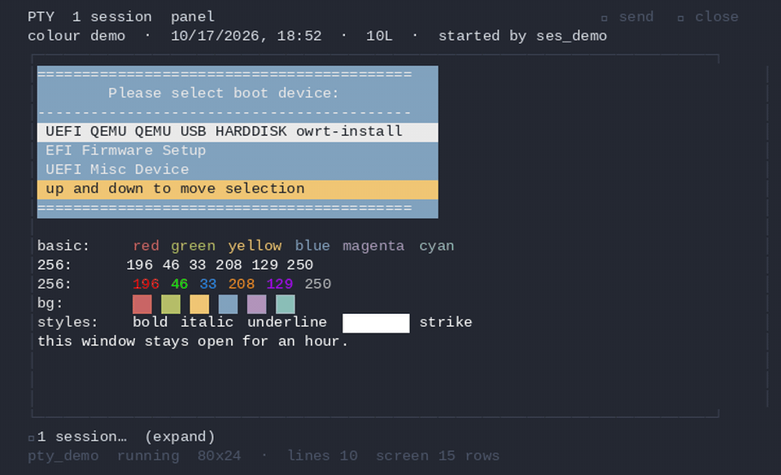

# opencode-pty

> Run long-lived processes the agent can read, write to and wait on.
> Stop wrapping dev servers in `&`.

[](https://github.com/lenucksi/opencode-pty/actions/workflows/ci.yml)
[](https://github.com/lenucksi/opencode-pty)
[](https://www.npmjs.com/package/opencode-pty)
[](LICENSE)

A plugin for [OpenCode](https://opencode.ai) that gives the agent real PTY sessions:
run dev servers, watchers, REPLs and TUIs in the background, send them input, read
their output on demand, and get notified when they exit. Multiple sessions, real
terminal emulation, a web UI and a TUI panel.

**Status:** actively maintained on `local/modernized` (0.7.1). Fork of
[shekohex/opencode-pty](https://github.com/shekohex/opencode-pty); features are kept in a
shape that can be contributed upstream.

## Why?

OpenCode v2 can background shell calls — so this plugin isn't about *whether* a process
runs in the background. It's about **real terminal emulation** and **shared control**:

- **Processes that need a TTY** — certain Ansible plays, SSH sessions, anything that prompts or formats for a terminal.
- **Long-running serial connections** — a VM's EFI/boot manager, a serial console you drive for minutes or hours.
- **Interactive programs** — REPLs, `top`, `vim`, prompts, TUIs.
- **Dev servers & watchers** (`bun run dev`, `cargo watch`, `bun test --watch`).

With a PTY, the agent and a human can send input to the *same* running process, short or
long-lived, and both watch it through the web UI or the TUI panel. You get a real terminal
buffer with byte-exact paging, mouse reporting, selection, true colour, and exit
notifications instead of polling — like tmux, but agent-native.

## Install

OpenCode V2 (recommended):

```json
{
  "$schema": "https://opencode.ai/config.json",
  "plugin": [{ "package": "opencode-pty/v2", "options": { "port": 4200, "autostart": true } }]
}
```

V1 is deprecated and will disappear without further notice — use `opencode-pty/v2`.

## Try it

Ask the agent: *"Start `bun run dev` as a background session and tell me when it's ready."*
It will call `pty_spawn`, wait for `<pty_exited>`/`pty_wait`, and report the URL.

## One session, end to end

```
pty_spawn: command="bun", args=["run","dev"], description="Dev server", title="Dev Server"
→ <pty_spawned id="pty_a1b2c3d4" cols="240" rows="80">

pty_read:  id="pty_a1b2c3d4", limit=50
→ last 50 lines of output

pty_read:  id="pty_a1b2c3d4", pattern="error|ERROR", ignoreCase=true
→ only the matching lines

pty_write: id="pty_a1b2c3d4", data="\x03"
→ Ctrl+C

pty_kill:  id="pty_a1b2c3d4", cleanup=true
→ terminated and freed
```

## Why this over the alternatives

- **vs. OpenCode's `bash` tool**: `bash` blocks until the process exits. PTYs run in the background and the agent reads, writes and waits on its own schedule — and gives the agent a real terminal, not a pipe.
- **vs. `tmux`/`screen`**: no second tool to learn, no pane to attach to. Sessions are first-class objects the agent can list, resize, screenshot and kill, with a web UI and a TUI panel.
- **vs. shelling out with `&`**: real terminal emulation (mouse reporting, selection, true colour), a bounded output buffer with byte-exact paging, and exit notifications instead of polling.

## Common invocations

```bash
# Dev server, sized for a wide terminal
pty_spawn({ command: "bun", args: ["run","dev"], description: "Dev server", cols: 200, rows: 50 })

# Serial console (raw line discipline — Enter arrives as CR, not LF)
pty_spawn({ command: "virsh", args: ["-c","qemu:///system","console","--force","myguest"],
            description: "Guest serial console", raw: true })

# Build, then wait for it
pty_spawn({ command: "npm", args: ["run","build"], description: "Build", notifyOnExit: true })
pty_wait({ id: "pty_..." })

# Full-screen program as a screen, not a byte stream
pty_screen({ id: "pty_..." })
```

## Configuration

Environment variables (full table in [`docs/configuration.md`](docs/configuration.md)):

| Variable | Default | What it does |
|---|---|---|
| `PTY_MAX_BUFFER_LINES` | `50000` | Lines kept per session |
| `PTY_READ_MAX_TOKENS` | `25000` | Default `pty_read` budget |
| `PTY_WEB_PORT` | `0` (random) | Web UI port |
| `PTY_WEB_HOSTNAME` | `::1` | Web UI bind host |

Plugin options (V2): `port`, `hostname`, `autostart`, `retention`. Archive retention
(`maxSessions`, `maxAgeDays`, `maxBytesPerSession`) is enforced on the shared on-disk
archive; see `docs/configuration.md`.

Permissions: respects OpenCode's `permission.bash`. `"ask"` is treated as `"deny"`
(plugins cannot prompt). See `docs/configuration.md`.

## Status, versioning, upgrade

- **Status**: actively maintained on `local/modernized` (0.7.1). Fork of
  [shekohex/opencode-pty](https://github.com/shekohex/opencode-pty); features are kept in a
  shape that can be contributed upstream.
- **Versioning**: SemVer. Breaking changes get a major bump.
- **Upgrade**: OpenCode checks for plugin updates on startup. Force a clean reinstall with
  `rm -rf ~/.cache/opencode/node_modules/opencode-pty && opencode`.

## Web UI & TUI panel




- **Web UI**: React/xterm, real-time WebSocket streaming, mouse selection, themes,
  download, session groups, coloured output. Start with `/pty-open-background-spy`.
- **TUI panel**: a PTY section in OpenCode's sidebar (2.0.23+) and a per-conversation
  session panel (`/pty-sessions`), with coloured output, scrollback and a command line.
- **REST API + WebSocket**: see [`docs/api.md`](docs/api.md).
- **Version identity**: `GET /api/server` and the Settings dialog show the build's version
  + commit.

## How it works

1. **Spawn**: bun-pty runs the command in the background.
2. **Buffer**: rolling ring buffer (default 1 MB) with absolute character offsets.
3. **Read**: byte-exact paging via `since`; regex filtering; whole-result token budget.
4. **Screen**: `pty_screen` replays the buffer through the same VT parser the web UI uses.
5. **Write**: any input, including escape sequences.
6. **Lifecycle**: sessions persist until cleanup; auto-cleanup on session end.
7. **Notify**: `notifyOnExit` sends a `<pty_exited>` message.

More detail: [`docs/how-it-works.md`](docs/how-it-works.md), [`docs/diagrams.md`](docs/diagrams.md).

## Documentation

- [`docs/api.md`](docs/api.md) — REST API and WebSocket streaming
- [`docs/configuration.md`](docs/configuration.md) — environment variables, permissions, retention
- [`docs/web-ui.md`](docs/web-ui.md) — Web UI features and starting it
- [`docs/tui-panel.md`](docs/tui-panel.md) — TUI sidebar and session panel
- [`docs/how-it-works.md`](docs/how-it-works.md) — buffer, paging, screen rendering
- [`docs/diagrams.md`](docs/diagrams.md) — sequence diagrams
- [`docs/development.md`](docs/development.md) — local setup and quality gate

## Local development

```bash
bun install --force --frozen-lockfile
bun run test:local   # full quality gate (~15 steps)
bun run test:llm     # real model, costs tokens
bun run capture:demo # regenerate docs/media/web-ui-demo.gif
```

See [`docs/development.md`](docs/development.md).

## Licence

MIT — see [LICENSE](LICENSE).

## Contributing

Contributions welcome. Open an issue or PR. See [`CONTRIBUTING.md`](CONTRIBUTING.md).

## Credits

- [OpenCode](https://opencode.ai) — the coding assistant this plugin extends
- [bun-pty](https://github.com/sursaone/bun-pty) — cross-platform PTY for Bun
- [shekohex/opencode-pty](https://github.com/shekohex/opencode-pty) — the upstream project this fork is based on; thanks for the original work

---

V1 (`index.ts`) is deprecated and will disappear without further notice — use `opencode-pty/v2`.
```