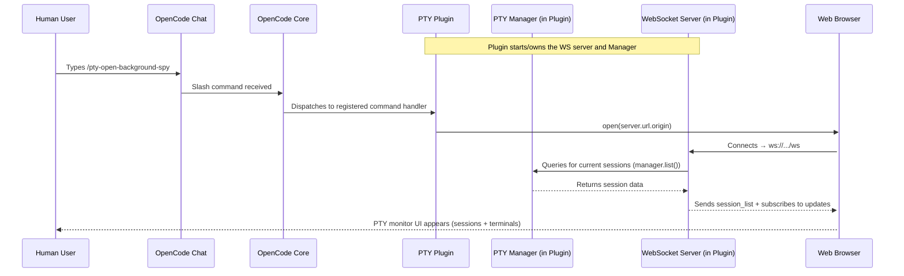
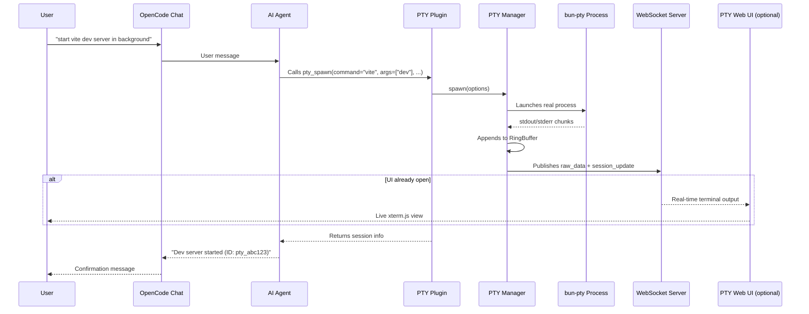
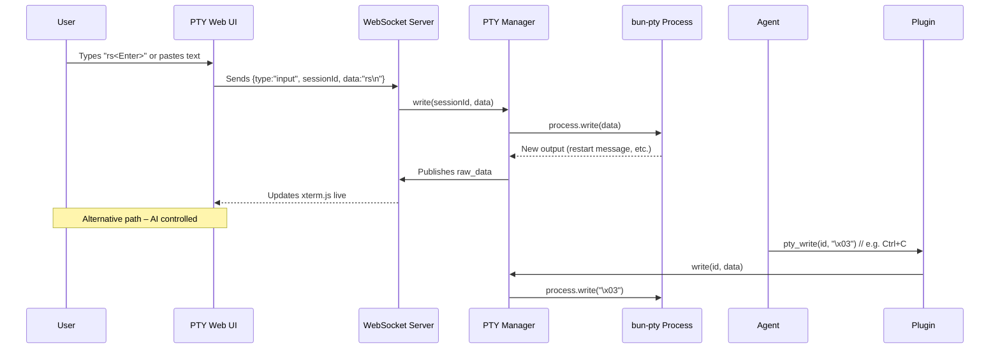
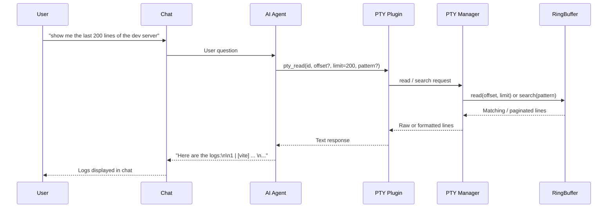
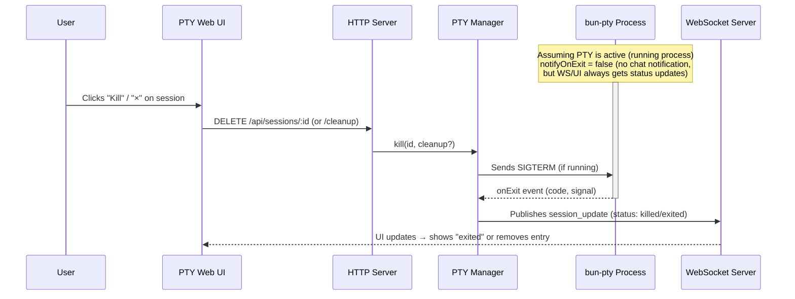
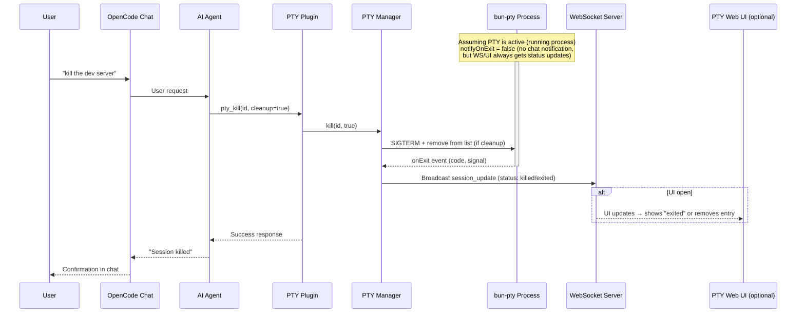
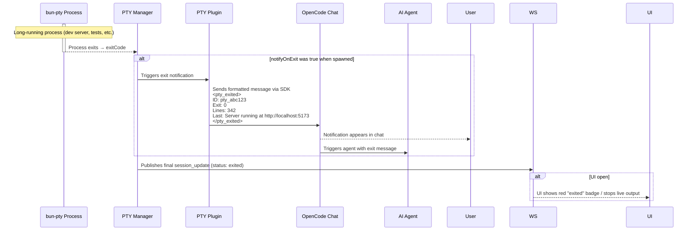

# Diagrams

## Diagrams

### Sequence

#### Use Case 1 – Opening the PTY Monitor Web UI

#### Use Case 2 – Starting a Long-Running Background Process

#### Use Case 3 – Sending Interactive Input to a Running Session

#### Use Case 4 – Reading Output / Logs On Demand

#### Use Case 5A – Killing / Cleaning Up a Session via Web UI

#### Use Case 5B – Killing / Cleaning Up a Session via Agent

#### Use Case 6 – Automatic Exit Notification

